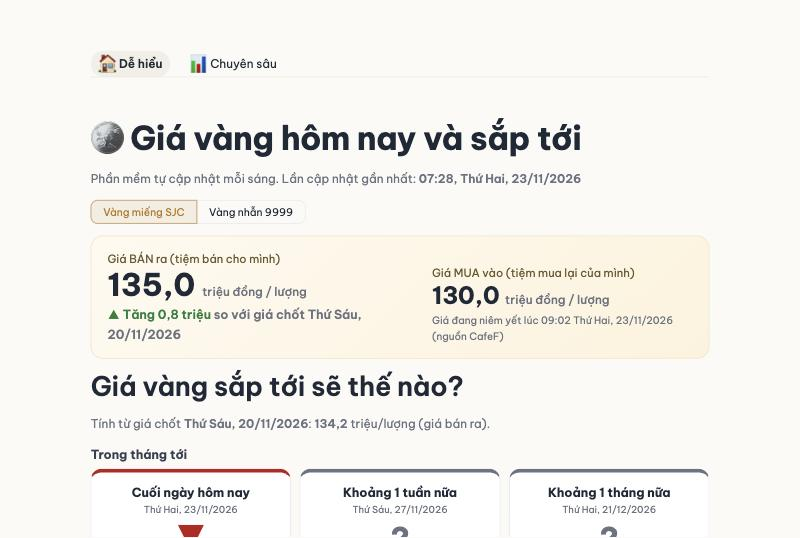
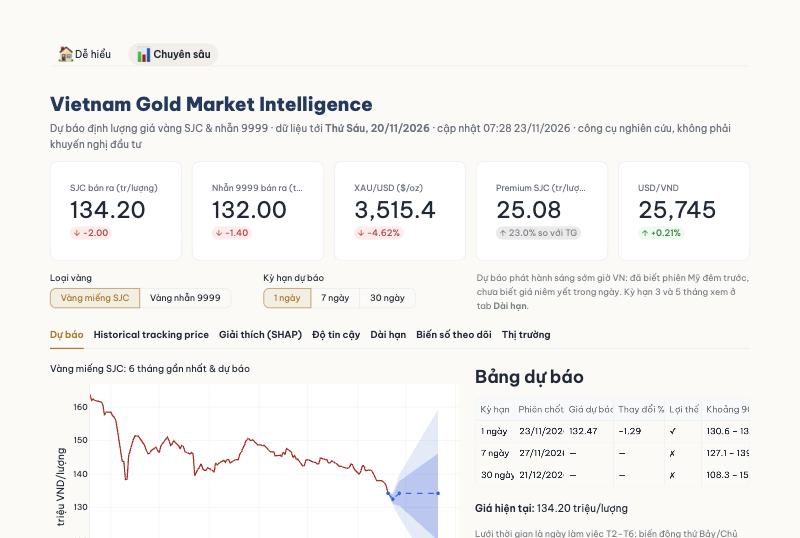
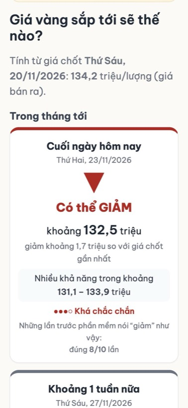

# 🪙 Vietnam Gold Forecast · Dự báo giá vàng Việt Nam


Dự báo giá **vàng miếng SJC** và **vàng nhẫn 9999** (giá nhẫn trơn PNJ 999.9) cho ngày mai, tuần sau, tháng sau và 3–5 tháng tới.
Hệ thống kết hợp mô hình chuỗi thời gian, học máy và một lớp tự học từ sai số. Kết quả được kiểm định
**walk-forward** trung thực và có trang **đối chiếu lịch sử** dùng giá thời gian thực.

*Forecasting Vietnamese gold prices (SJC bars & 9999 rings) with an ensemble of statistical and ML models,
honest walk-forward evaluation, SHAP explanations and live track-record scoring. Two UIs: a plain-language
view for non-technical users and a professional analytics view.*

> ⚠️ Công cụ nghiên cứu, **không phải khuyến nghị đầu tư**.

## 📱 Cài lên điện thoại

Mở **https://dnqh.github.io/vn-gold-forecast/** trên điện thoại rồi thêm vào màn hình chính để mở nhanh bằng một chạm:

- **iPhone (Safari):** bấm nút **Chia sẻ** → **Thêm vào MH chính**.
- **Android (Chrome):** bấm **⋮** → **Thêm vào màn hình chính** (hoặc bấm nút **Cài vào điện thoại** trên trang).

Dự đoán được cập nhật mỗi sáng khoảng 7 giờ (khi máy Mac chạy dự báo đang bật); giá đang niêm yết được làm mới mỗi 5 phút.
Ứng dụng là trang web tĩnh trong thư mục `docs/` (GitHub Pages, chạy được khi mất mạng nhờ service worker), dữ liệu
xuất bằng `scripts/export_web.py`. Sau khi sửa `docs/app.js`/`style.css`/`index.html`, tăng `VERSION` trong `docs/sw.js`
để điện thoại chuyển sang bản mới ngay (nếu quên, điện thoại vẫn tự lấy bản mới ở lần mở kế tiếp).

## Hai phiên bản giao diện

| 🏠 **Dễ hiểu**: cho người lớn tuổi, người không rành công nghệ | 📊 **Chuyên sâu**: cho người làm phân tích |
|---|---|
|  |  |
| Chữ to, nói bằng lời thường. Màu xanh = tăng, đỏ = giảm, xám = khó đoán. Có khoảng giá dễ hiểu, câu “những lần trước nói vậy thì đúng X/10 lần”, chấm xanh/đỏ cho 30 lần đoán gần nhất, và lưu ý về chênh lệch mua – bán. Hiển thị tốt trên điện thoại. | Bảng dự báo từng mô hình, khoảng tin cậy 80/90%, Historical tracking price, SHAP, kiểm định Diebold–Mariano, giai đoạn khoá, triển vọng dài hạn và biến số cần theo dõi. |

<p align="center"><br><sub>Bản Dễ hiểu trên điện thoại</sub></p>

### Nguyên tắc trung thực

- **Chỉ nói “tăng/giảm” khi đã chứng minh được.** Hiện chỉ kỳ hạn *phiên kế tiếp* vượt dự báo Naive có ý nghĩa thống kê.
  Với 1 tuần và 1 tháng, giao diện ghi **“Khó đoán”** và chỉ đưa khoảng giá.
- **3 – 5 tháng: không dự đoán chiều.** Phần mềm công bố khoảng giá đối xứng, hiệu chỉnh từ sai số lịch sử,
  kèm độ phủ thực tế đã kiểm định.
- **Xác suất được kiểm chứng.** Câu “những lần trước nói vậy thì đúng X/10 lần” được tính từ backtest walk-forward;
  phiên giá đứng yên được tính là *không đúng* (thận trọng). Khoảng “nhiều khả năng” là khoảng 80%: độ phủ thực tế
  76–86% tùy kỳ hạn (xem `reports/02_model_evaluation.md`), nên giao diện ghi “khoảng 8 trên 10 lần”.

## Bắt đầu nhanh

```bash
git clone <địa chỉ repo của bạn> && cd vn-gold-forecast
python -m venv .venv && source .venv/bin/activate
pip install -r requirements.txt

streamlit run app/dashboard.py          # mở giao diện, dùng sẵn dữ liệu trong data/processed
python scripts/run_pipeline.py          # cập nhật dữ liệu + backtest + dự báo (~15 phút lần đầu)
python scripts/run_pipeline.py --fast   # bản chạy hằng ngày: bỏ LSTM/ablation/EDA (~10 phút)
python scripts/export_web.py            # xuất docs/data/latest.json cho ứng dụng điện thoại
python -m pytest tests -q               # kiểm thử (chống rò rỉ dữ liệu, độ mới dữ liệu, logic chung Python/JS)
```

### Bản Streamlit trên web (tùy chọn)

Cả nhà nên dùng **ứng dụng điện thoại** ở trên. Bản Streamlit có thể đưa lên [Streamlit Community Cloud](https://share.streamlit.io)
(file chính `app/dashboard.py`, thư viện rút gọn `app/requirements.txt`), nhưng lưu ý: các file lớn trong `data/processed/`
(backtest, dataset) chỉ được đẩy lên repo **mỗi tuần một lần**, nên phần đối chiếu lịch sử trên bản này có thể trễ vài ngày.

### Lịch chạy tự động mỗi sáng (macOS)

```bash
./scripts/install_schedule.sh           # cài 2 lịch launchd: 7h00 sáng T3–T7 (dự báo) và 19h00 T2–T6 (thông báo)
./scripts/install_schedule.sh remove    # gỡ lịch
```

`scripts/daily.sh` làm các việc: thu thập dữ liệu, chấm điểm dự báo cũ, chạy lại walk-forward và lớp tự học,
ra dự báo mới, xuất dữ liệu cho ứng dụng điện thoại, commit + push và ghi log vào `logs/`. Bản sáng chạy **im lặng**
(không hiện thông báo); kết quả ghi vào `logs/.morning_status`, và nếu sáng nay lỗi thì thông báo 19h sẽ nhắc.

**Tự chạy bù khi máy tắt/ngủ lúc 7h:** launchd chạy `daily.sh` lúc 7h00, khi đăng nhập/khởi động máy và mỗi 15 phút.
Script tự kiểm tra: chỉ chạy vào thứ Ba – thứ Bảy, sau 7h00 giờ VN, và khi hôm nay chưa chạy thành công
(dấu `logs/.last_success`). Vì vậy bật máy muộn hơn 7h vẫn được chạy bù ngay (log có ghi "chạy bù=1").
Tối đa 3 lần thử mỗi ngày (tránh báo lỗi liên tục khi mất mạng); có khoá chống chạy trùng; chờ mạng tối đa ~2 phút.
Kiểm tra quyết định mà không chạy: `./scripts/daily.sh --check-only` (thử giờ giả: `VNGOLD_NOW='2026-11-26 08:00'`).
`--force` bỏ qua kiểm tra. Tuỳ chọn: tự bật máy lúc 6h55 (tự chạy trong terminal, cần mật khẩu):
`sudo pmset repeat wakeorpoweron TWRFS 06:55:00`

- **Hằng ngày** chỉ commit file nhỏ: `docs/data/`, `data/processed/forecast.json`, `data/processed/predictions_log.csv`.
- **Lần chạy thứ Bảy** (hoặc `FULL_PUSH=1 ./scripts/daily.sh --publish-only`) commit thêm `data/processed/`, `reports/`, `data/raw/`.
  Các file này bị ghi lại gần như toàn bộ mỗi ngày (đo được 0,2–1,1 MB nén/commit); đẩy hằng ngày sẽ làm repo công khai phình thêm hàng trăm MB mỗi năm.
- Trước khi push, script `fetch` + `rebase --autostash` lên `origin/main` (sửa README trên GitHub không làm hỏng lịch);
  nếu xung đột thì huỷ rebase, ghi lỗi vào log và `logs/.morning_status` (thông báo 19h sẽ nhắc).
- `AUTO_PUSH=0` (sửa trong file hoặc biến môi trường) để tắt commit/push; `./scripts/daily.sh --publish-only` để chỉ xuất + đăng.

## 🔔 Thông báo 19h

Mỗi tối **thứ Hai – thứ Sáu lúc 19h** (giờ Việt Nam), máy Mac gửi **một** thông báo, cùng lúc tới **điện thoại**
(qua ứng dụng miễn phí [ntfy](https://ntfy.sh)) và **máy Mac**. Bấm vào thông báo sẽ mở ứng dụng giá vàng. Nội dung:

1. **Giá hôm nay** của vàng miếng SJC và nhẫn 9999 (PNJ): giá bán, giá mua (triệu đồng/lượng) và tăng/giảm so với hôm qua
   (thứ Hai thì so với thứ Sáu).
2. **Dự báo sáng nay cho hôm nay có đúng chiều không** (đúng / sai / giá đứng yên) – chỉ khi sáng nay phần mềm có nói chiều.
3. **Dự báo sơ bộ cho phiên kế tiếp** (tối thứ Sáu là cho thứ Hai): mức độ (“Nghiêng rõ về tăng”, “Hơi nghiêng về giảm”,
   “Khó đoán”…) và khoảng giá nhiều khả năng.

Ví dụ:

```
Giá vàng tối Thứ Năm 26/11
Giá hôm nay (triệu đồng/lượng, so với hôm qua):
• SJC miếng: bán 134,5 – mua 129,5 (▲ 0,4 · +0,3%)
• Nhẫn 9999 PNJ: bán 132,5 – mua 127,0 (▲ 1,0 · +0,8%)
Sáng nay đoán: SJC giảm → sai · Nhẫn giảm → sai
Dự báo sơ bộ cho Thứ Sáu 27/11:
• SJC: Khó đoán, khoảng 133,0 – 136,2
• Nhẫn: Khó đoán, khoảng 130,8 – 134,2
Khó đoán: buổi tối chưa có giá Mỹ đêm nay, phần mềm chưa đoán tăng/giảm tốt hơn việc coi như giá giữ nguyên.
Đây là bản sơ bộ. Bản chính thức cập nhật lúc 7h sáng trên ứng dụng.
```

**Sơ bộ và chính thức khác nhau thế nào?** Bản **chính thức** chạy lúc 7h sáng, khi phiên giao dịch ở Mỹ đêm trước đã đóng
cửa – đây là nguồn lợi thế chính của phần mềm. Lúc 19h phiên Mỹ chưa diễn ra, nên bản **sơ bộ** dùng các mô hình của bản
sáng với giá thế giới *đang chạy* lúc 19h. Kiểm định walk-forward trên ~2 năm dữ liệu theo giờ
([`reports/04_evening_preliminary.md`](reports/04_evening_preliminary.md)) cho thấy bản sơ bộ **chưa vượt** cách “coi như giá
giữ nguyên” một cách có ý nghĩa thống kê, nên hiện thông báo ghi **“Khó đoán”** và chỉ đưa khoảng giá. Phần mềm tự kiểm định
lại mỗi tuần (`scripts/eval_evening.py`); chỉ khi có lợi thế thật thì thông báo mới nói chiều. Hãy xem bản chính thức trên
ứng dụng sau 7h sáng.

**Cài trên điện thoại (cả bố mẹ dùng chung được):**

1. Cài ứng dụng **ntfy** (App Store trên iPhone, Google Play trên Android) – miễn phí, không cần tài khoản.
2. Mở ntfy → bấm **+** (Subscribe to topic / Đăng ký chủ đề).
3. Nhập **tên chủ đề** (topic) – xem trong file `config/notify.env` trên máy Mac, dòng `NTFY_TOPIC=...` – giữ máy chủ
   mặc định **ntfy.sh** → **Subscribe**. Mỗi điện thoại trong nhà làm giống hệt nhau với cùng một tên chủ đề.
4. iPhone: cho phép ntfy gửi thông báo khi được hỏi.

**Tên chủ đề là “chìa khoá”:** ai biết tên đều đọc được tin, nên tên được tạo ngẫu nhiên khó đoán và **chỉ** lưu trong
`config/notify.env` (đã đưa vào `.gitignore`, không bao giờ lên GitHub; mẫu: `config/notify.env.example`). Tin nhắn chỉ có
giá vàng, không có thông tin cá nhân. **Đổi tên chủ đề:** tạo tên mới bằng
`python3 -c "import secrets; print('vngold-' + secrets.token_hex(10))"`, sửa dòng `NTFY_TOPIC=` trong `config/notify.env`,
rồi đăng ký lại tên mới trên từng điện thoại (xoá chủ đề cũ).

**Lịch và gửi bù:** `scripts/evening.sh` (launchd `com.vngold.evening`, cài bằng `./scripts/install_schedule.sh`) chạy lúc
19h00, khi đăng nhập/khởi động máy và mỗi 15 phút. Máy Mac phải **bật** (không ngủ) thì mới gửi được; nếu lúc 19h máy tắt,
khi bật lại trong cùng buổi tối tin sẽ được **gửi bù** (tiêu đề có “(gửi bù)”). Qua nửa đêm thì không gửi bù tin hôm trước.
Mỗi ngày chỉ gửi một lần (dấu `logs/.evening_last_success`), tối đa 3 lần thử, có khoá chống chạy trùng, chờ mạng tối đa
~2 phút, và đợi nếu bản sáng đang chạy bù. Một kênh lỗi thì kênh kia vẫn được gửi; kết quả ghi vào `logs/evening_<ngày>.log`.

```bash
./scripts/evening.sh --check-only          # xem quyết định của guard (giờ giả: VNGOLD_NOW='2026-11-26 19:05')
./scripts/evening.sh --dry-run --force     # in nội dung tin nhắn, KHÔNG gửi
./scripts/evening.sh --force               # gửi ngay (trước 19h: tiêu đề "(gửi thử)", tin 19h vẫn gửi như thường)
python scripts/eval_evening.py             # kiểm định lại bản sơ bộ (~2 phút; tự chạy mỗi tuần sau khi gửi)
```

## Kiến trúc

```
Data Collection ─► Data Processing ─► Feature Engineering ─► ML Prediction Engine ─► forecast.json ─► Streamlit / PWA
 (Yahoo, FRED,      (ghép nguồn, lưới    (~70 đặc trưng:       (Naive, MA, Linear,          │           ├─ Dễ hiểu
  CafeF,            ngày làm việc,        returns, premium,     ARIMA, RF, XGBoost,          │           └─ Chuyên sâu
  giavang.org)      chống leakage)        RSI, MACD, macro…)    LSTM) + lớp tự học           │
                                                                                             ├─► Walk-forward, DM test
                                                                                             ├─► SHAP
                                                                                             └─► Triển vọng 3–5 tháng
```

| Module | File |
|---|---|
| Thu thập dữ liệu (kể cả giá live) | `src/vngold/data/collect.py` |
| Xử lý dữ liệu | `src/vngold/data/process.py` |
| Đặc trưng | `src/vngold/features.py` |
| Mô hình | `src/vngold/models.py`, `src/vngold/lstm_worker.py` |
| Tự học từ sai số | `src/vngold/online.py` |
| Đối chiếu lịch sử | `src/vngold/tracking.py` |
| Triển vọng dài hạn | `src/vngold/outlook.py` |
| Đánh giá | `src/vngold/evaluation.py` |
| Giải thích (SHAP) | `src/vngold/explain.py` |
| EDA | `src/vngold/eda.py` → `reports/01_eda.md` |
| Điều phối | `src/vngold/pipeline.py`, `scripts/run_pipeline.py` |
| Giao diện | `app/dashboard.py` (điều hướng), `app/views/family.py`, `app/views/pro.py`, `app/ui.py` |
| Logic dùng chung (độ mới dữ liệu, tỷ lệ đúng) | `src/vngold/plain.py` |
| Ứng dụng điện thoại (PWA) | `docs/` (`index.html`, `app.js`, `sw.js`), dữ liệu: `scripts/export_web.py` → `docs/data/latest.json` |
| Dự báo sơ bộ 19h + kiểm định | `src/vngold/evening.py`, `scripts/eval_evening.py` → `reports/04_evening_preliminary.md` |
| Thông báo 19h (ntfy + macOS) | `src/vngold/notify.py`, `scripts/evening.py`, `scripts/evening.sh`, `scripts/com.vngold.evening.plist` |

## Triển vọng dài hạn (3 và 5 tháng)

Ở kỳ hạn 7 và 30 ngày, mô hình đã không vượt Naive. Tỷ lệ giá tăng sau 3–5 tháng cũng đổi chiều mạnh giữa các năm
(2025 gần như luôn tăng, 2026 phần lớn giảm). Vì vậy `outlook.py` **không** đưa ra xác suất tăng ở các kỳ hạn này,
mà công bố một khoảng giá 80% đối xứng:

- Lấy biến động ngày của 126 phiên gần nhất, nhân √h.
- Nhân thêm hệ số bằng phân vị 80% của các sai số chuẩn hoá **đã đáo hạn** (cửa sổ mở rộng, không dùng thông tin tương lai).

Độ phủ thực tế được báo cáo kèm theo. Với SJC, khoảng này phủ khoảng 64–67% trên toàn giai đoạn và 91–100% trong giai đoạn khoá:
khoảng đối xứng đánh giá thấp các đợt tăng kéo dài.

## Historical tracking price (tab trong bản Chuyên sâu)

Tab này giúp người xem tự kiểm tra: **với cách dự báo hiện tại, quá khứ khớp đến đâu?**
- Mỗi điểm là một dự báo lập trong quá khứ, chỉ dùng dữ liệu có đến ngày lập (walk-forward, mô hình huấn luyện lại
  theo thời gian, lớp tự học chỉ học từ sai số đã biết). Điểm đó được đặt cạnh giá thực tế của đúng phiên đích.
- Có 3 nguồn: **Live** (dự báo thật đã lưu lúc phát hành, ưu tiên khi trùng ngày), **Giai đoạn khoá**
  (backtest sau khi đã chốt cấu hình) và **Backtest** (giai đoạn trước).
- **Giá live:** dashboard lấy giá niêm yết mới nhất từ CafeF, tự làm mới mỗi 5 phút. Các dự báo đến hạn hôm nay
  được chấm tạm bằng giá này. Điểm chính thức chốt theo giá cuối phiên ở lần chạy 7h sáng hôm sau.
- Các chỉ số hiển thị:
  - sai số trung bình (triệu đồng và %), so với Naive;
  - tỷ lệ giá thật nằm trong khoảng 90%, tỷ lệ đúng chiều;
  - mức độ gần/xa: Rất gần ≤ 0,5% · Gần ≤ 1% · Khá xa ≤ 2% · Xa, ngưỡng nới theo √kỳ hạn;
  - bảng theo tháng, bảng chi tiết, tải CSV.
- Hàm dùng chung: `tracking.historical_tracking()` và `tracking_summary()`. Hàm lấy giá live: `collect.fetch_live_prices()`.

## Dữ liệu (5 nhóm)

| Nhóm | Biến | Nguồn |
|---|---|---|
| 1. Vàng quốc tế | XAU/USD (GC=F), khối lượng, biến động, bạc | Yahoo Finance |
| 2. Vĩ mô | DXY, US10Y, lãi suất thực 10Y, Fed funds, kỳ vọng lạm phát, CPI YoY, thất nghiệp | Yahoo, FRED |
| 3. Thị trường trong nước | SJC mua/bán, nhẫn 9999, USD/VND, **Domestic Gold Premium**, spread | giavang.org, CafeF |
| 4. Tâm lý / sự kiện | VIX, vía Thần Tài, giai đoạn chính sách (đấu thầu 2024, NHNN bán trực tiếp, NĐ 232/2025) | tự xây |
| 5. Kỹ thuật | RSI, MACD, MA20/50, Bollinger, ATR, ROC, volatility 7/21 | tính từ giá |

**Domestic Gold Premium:**  `P_World^VND = XAUUSD × USDVND × 37.5/31.1035`, `Premium = P_Vietnam − P_World^VND` (triệu VND/lượng).

Lịch sử giá SJC 01/2017 → nay, ghép từ: giavang.org (2017 – 10/2024), giá SJC niêm yết tại PNJ
(lấp khoảng trống 11/2024 – 02/2025, khớp giá SJC chính thức ở các ngày trùng), CafeF (02/2025 → nay).
Vàng nhẫn có lịch sử từ 03/2024 (nhẫn PNJ 999.9 làm nguồn chính, nhẫn SJC 99,99 lấp ngày thiếu).

### Chống rò rỉ dữ liệu (data leakage)
- Lưới thời gian là ngày làm việc; **hàng t = thông tin có tại thời điểm phát hành dự báo**.
- Giá thế giới: phiên Mỹ ngày d đóng cửa ~4–5h sáng d+1 giờ VN → chỉ dùng khi đã có.
- FRED daily trễ 2 ngày; CPI trễ 47 ngày, thất nghiệp trễ 40 ngày (xấp xỉ ngày công bố, không dùng ngày quan sát).
- Walk-forward: tại mốc s chỉ học các hàng i có i + h ≤ s (nhãn đã biết). **Không chia ngẫu nhiên.**
- Ngày thị trường trong nước nghỉ (giá chỉ được điền tiếp) không được dùng làm nhãn.
- `tests/test_leakage.py` kiểm tra tự động các điều kiện trên.

## Mô hình

Tất cả dự báo **lợi suất log** `r = ln P(t+h) − ln P(t)` rồi quy đổi `P̂ = P·e^r̂` (giá log không dừng: ADF p≈0.98; lợi suất dừng).

| Model | Vai trò |
|---|---|
| Naive | Benchmark: giá tương lai = giá hôm nay |
| Moving Average | Benchmark: trung bình 5 phiên |
| Linear Regression (Ridge) | Baseline nhiều biến |
| ARIMA(1,0,1) | Chuỗi thời gian |
| Random Forest | Phi tuyến |
| **XGBoost** | Mô hình chính (+ SHAP), trọng số ưu tiên dữ liệu gần (half-life 750 phiên) |
| LSTM (PyTorch) | Chuỗi 20 phiên, học tiếp (warm-start) mỗi lần cập nhật |
| ECM | Mô hình hiệu chỉnh sai số theo giá thế giới (premium trong nước so với giá quốc tế quy đổi), bật từ 24/11/2026 |

> **Ghi chú về ECM (bật từ 24/11/2026).** ECM (mô hình hiệu chỉnh sai số theo giá thế giới) là thành viên của ensemble tự học.
> Trên giai đoạn khoá, ensemble có ECM giảm RMSE khoảng 1–2% (SJC 2.00 → 1.96, nhẫn 2.13 → 2.11 triệu/lượng),
> nhưng khác biệt so với ensemble trước đó **không có ý nghĩa thống kê** (DM p = 0.27 / 0.74).
> Sẽ đánh giá lại sau 3–6 tháng dữ liệu chạy thật. Tắt bằng biến môi trường `VNGOLD_USE_ECM=0`.
> Chi tiết: [`reports/03_accuracy_experiments.md`](reports/03_accuracy_experiments.md).

### Cơ chế tự học sau mỗi dự báo (`online.py`)
Khi giá thực tế của ngày đích được công bố (sau h phiên), hệ thống so sánh với dự báo đã lập và cập nhật:
1. **Trọng số theo kỹ năng so với Naive.** `skill = EWMSE_mô hình / EWMSE_Naive`, `w ∝ exp(−η·(skill − min))`.
   Mô hình kém Naive hơn 5% bị loại tạm thời. Half-life và η điều chỉnh theo √h (sai số kỳ hạn dài chồng lấn nhau).
2. **Hiệu chỉnh độ lệch có kiểm soát.** Chỉ áp dụng cho mô hình mà bản hiệu chỉnh đã chứng minh tốt hơn bản thô trên các dự báo đã đáo hạn.
3. **Khoảng tin cậy tự nới/co.** Phân vị của 250 sai số gần nhất (ACI) nhân với hệ số `k`.
   `k` tăng khi thực tế rơi ngoài khoảng nhiều hơn mức danh nghĩa và giảm khi ngược lại.
4. **Huấn luyện lại** định kỳ với dữ liệu mới nhất (LSTM học tiếp từ trọng số cũ).
5. **Nhật ký dự báo thực tế** (`data/processed/predictions_log.csv`). Mỗi lần chạy tự chấm điểm các dự báo cũ đã đáo hạn.
   Dashboard hiển thị thành tích thực tế này.

Báo cáo có bảng **ablation lớp tự học** cho từng kỳ hạn. Kết quả trung thực: phần giúp ích là *trọng số theo kỹ năng*
(1 ngày: Theil U 0.935 → 0.914). *Hiệu chỉnh độ lệch* gần như không đóng góp. *Hệ số nới khoảng* đưa độ phủ 30 ngày từ 83% lên 88%.

## Kết quả walk-forward

Số liệu cập nhật tự động trong [`reports/02_model_evaluation.md`](reports/02_model_evaluation.md) sau mỗi lần chạy.
README không chép số cứng để tránh lệch. Ảnh chụp ngày 23/11/2026 cho vàng SJC:

| Kỳ hạn | Theil U Ensemble (DM p) | Đúng chiều / mốc "luôn đoán chiều phổ biến" | Bao phủ 90% | Giai đoạn khoá (12/2025→): U · đúng chiều/mốc · phủ 90% | Công bố |
|---|---|---|---|---|---|
| 1 ngày | **0.914** (p<0.001) | 66.1% / 55.4% (**+10.8 điểm**) | 90.2% | **0.901** · 68.4%/54.4% · 91.4% | Dự báo điểm |
| 7 ngày | 1.011 (p=0.53) | 50.5% / 59.7% (−9.2) | 89.5% | 1.016 · 54.9%/56.7% · 89.5% | Chỉ khoảng tin cậy |
| 30 ngày | 1.030 (p=0.63) | 59.3% / 66.3% (−7.0) | 87.7% | 1.120 · 52.7%/66.7% · 90.6% | Chỉ khoảng tin cậy |

**Những phát hiện chính (trung thực):**
- **1 ngày là kỳ hạn duy nhất có lợi thế thật.** Mô hình giảm ~9% RMSE so với Naive và đoán đúng chiều hơn mốc ~11 điểm %.
  Kết quả giữ nguyên ở giai đoạn khoá (chưa từng dùng để chỉnh tham số). Nguồn lợi thế là **độ trễ truyền dẫn**
  giá thế giới vào giá SJC. Nếu phát hành dự báo vào cuối ngày (chưa biết phiên Mỹ đêm đó) thì lợi thế biến mất (U ≈ 1.00).
- **7 và 30 ngày: không mô hình nào thắng Naive.** Tỷ lệ đúng chiều còn **thấp hơn** cách "luôn đoán tăng"
  (vàng tăng mạnh 2019–2026). Brier skill của P(tăng) âm. Vì vậy dashboard không đưa con số dự báo điểm cho các kỳ hạn này.
  Chỉ hiển thị khoảng tin cậy quanh giá hiện tại kèm cảnh báo "không vượt Naive".
- **Ablation đặc trưng:** nhóm *vàng thế giới* và *premium/pass-through* có giá trị rõ nhất ở 1 ngày. Nhóm vĩ mô và tỷ giá
  không thêm thông tin ở kỳ hạn ngắn.
- **Dự báo 1 năm** không được triển khai. Với dữ liệu hiện có, sai số sẽ lớn hơn nhiều so với Naive; nên dùng phân tích kịch bản.

### Các hạn chế đã biết
- Tham số mô hình được chọn khi đã nhìn backtest 2019–2025. Vì vậy chỉ số đáng tin nhất là **giai đoạn khoá** (sau `LOCK_DATE`)
  và **nhật ký dự báo thực tế**.
- GC=F là hợp đồng tương lai, không phải giá giao ngay. Đã đối chiếu với ETF GLD: không thấy bước nhảy đổi kỳ hạn có hệ thống,
  và biến động −11.4% ngày 30/01/2026 là thật (GLD −10.8%). Vẫn còn vài ngày lệch giờ chốt giá giữa hai nguồn.
- Lưới ngày làm việc T2–T6: biến động giá SJC cuối tuần được tính vào phiên thứ Hai.
- Ngày thị trường trong nước nghỉ (Tết, lễ) bị loại khỏi nhãn huấn luyện và chấm điểm.
- Vàng nhẫn dùng một nguồn nhất quán (nhẫn PNJ 999.9, CafeF) và chỉ có lịch sử từ 03/2024, nên kiểm định ngắn (~350 phiên).
- Nhóm tâm lý/địa chính trị mới có proxy (VIX, vía Thần Tài, giai đoạn chính sách).

## Lộ trình

- [x] **Phase 1** – Thu thập dữ liệu, EDA, dataset hoàn chỉnh
- [x] **Phase 2** – Prediction Engine (Linear, ARIMA, RF, XGBoost, LSTM), walk-forward, tự học từ sai số
- [~] **Phase 3** – SHAP ✅; chỉ số địa chính trị GPR, NLP/FinBERT sentiment, Google Trends, GDELT ⏳
- [~] **Phase 4** – Dashboard Streamlit ✅, lịch chạy tự động ✅; PostgreSQL, cache walk-forward cho bản chạy hằng ngày ⏳
- [ ] Hướng B – Quantitative Trading: chiến lược mua/bán, backtest lợi nhuận (tính cả spread mua-bán ~1–2%), quản trị rủi ro
