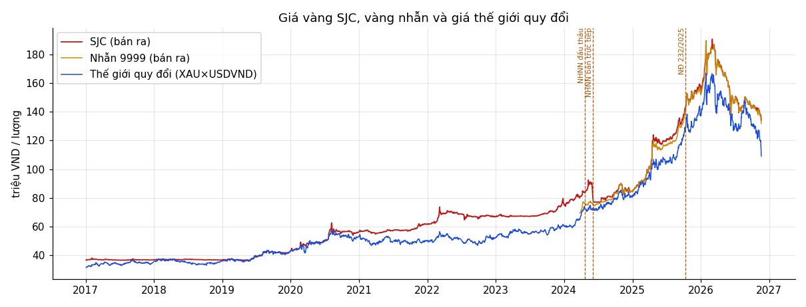
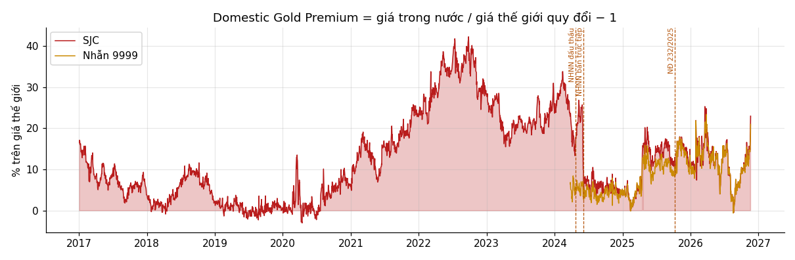
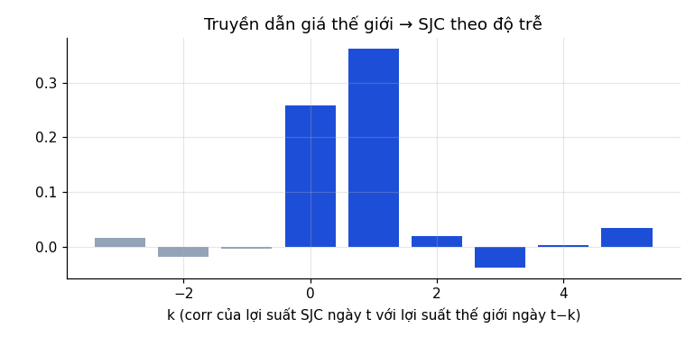
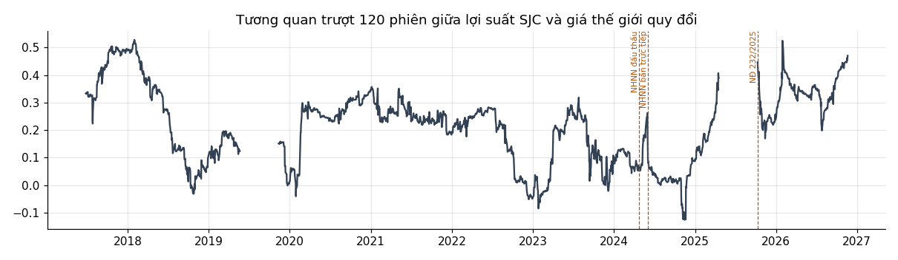
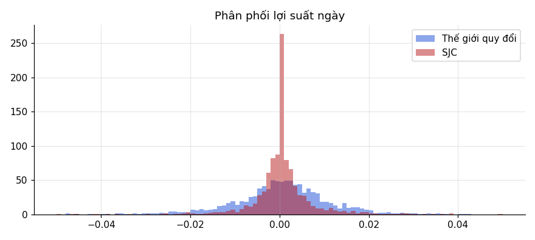
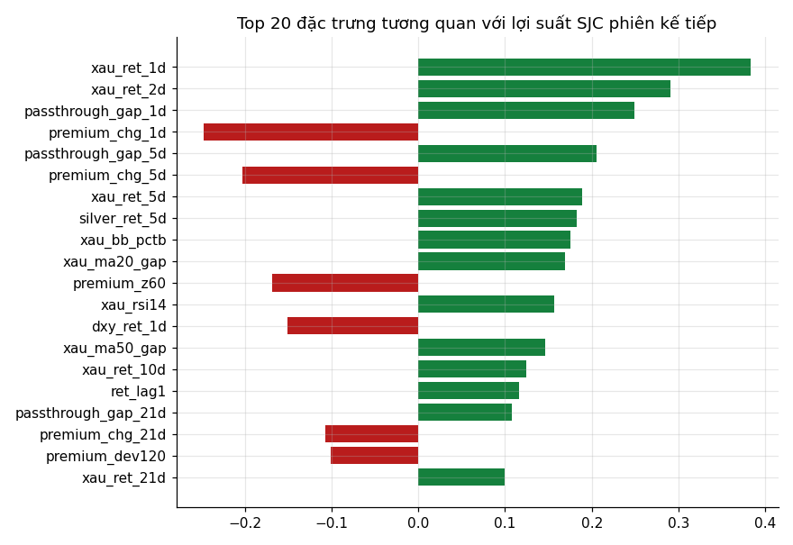

# Phase 1 – EDA: Thị trường vàng Việt Nam

- Giai đoạn: **03/01/2017 – 20/11/2026** (2491 phiên làm việc)
- Nguồn giá SJC theo số phiên: {'giavang.org': 1980, 'cafef': 451, 'pnj': 60}
- Biến động ngày: SJC **0.80%** vs thế giới quy đổi **1.16%**; độ nhọn (kurtosis) SJC = 29.0 (đuôi dày)
- 17% số phiên giá SJC không đổi
- ADF: log giá p = 0.975 (không dừng) · lợi suất p = 0 (dừng) ⇒ dự báo **lợi suất**, không dự báo trực tiếp giá
- Premium hiện tại **23.0%** (trung bình giai đoạn 12.3%)
- Tương quan lợi suất SJC(t) với thế giới(t−k): k=-3: 0.02, k=-2: -0.02, k=-1: -0.00, k=0: 0.26, k=1: 0.36, k=2: 0.02, k=3: -0.04, k=4: 0.00, k=5: 0.03

